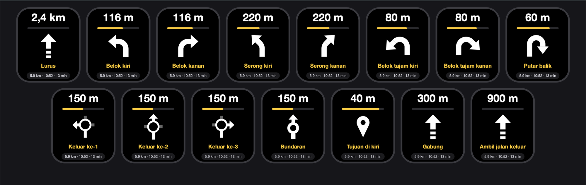
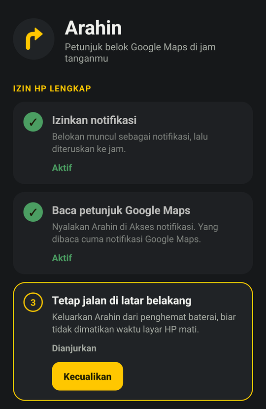

# Arahin

Petunjuk belok Google Maps di smartwatch, jadi waktu touring cukup lirik pergelangan tangan. Saya pakai dengan **Huawei Watch Fit 4**.

[Unduh APK](https://github.com/rikurunico/arahin/releases/latest) · [Demo interaktif](https://rikurunico.github.io/arahin/)



## Cara kerja

Notifikasi navigasi Google Maps cuma berisi jarak dan nama jalan. Arahnya ada di gambar panah. Arahin mencocokkan gambar itu dengan ikon yang diambil dari notifikasi Maps asli (`ManeuverIcon.kt`), lalu memunculkan notifikasi pendek seperti `◀ BELOK KIRI 200 m`. Huawei Health meneruskannya ke jam.

Maps memperbarui jarak kira-kira tiap 10 m, dan jam bakal getar tiap kali notifikasinya berubah. Karena itu Arahin cuma memunculkan notifikasi di **500**, **200**, dan **50 m** sebelum belokan (`AlertGate.kt`). Lurus, gabung jalur, dan jalan keluar tidak bikin getar.

Sudah saya coba di POCO F6 (Android 16) dengan Watch Fit 4.

## Pakai

1. Unduh `arahin.apk` dari [Releases](https://github.com/rikurunico/arahin/releases/latest) lalu pasang (Android 8.0+).
2. Buka Arahin dan ikuti checklist-nya sampai semua langkah wajib hijau. Jangan lupa nyalakan notifikasi Arahin di Huawei Health.
3. Mulai navigasi di Google Maps.



## Privasi

Arahin tidak punya izin `INTERNET`, hanya membaca notifikasi `com.google.android.apps.maps`, dan tidak mengirim nama jalan ke jam. Build release tidak mencatat log.

## Layar navigasi di jam (opsional)

Ada juga app kecil untuk jam yang menampilkan panah besar dan getar beda untuk kiri dan kanan. Source-nya di [`watch/`](watch/README.md). App ini perlu akun developer Huawei terverifikasi, izin **Wear Engine** (Basic device information), dan fingerprint signing di `WatchLink.kt` serta `watch/pages/index/index.js`. SHA-256 sertifikat APK release:

```
28:DA:EB:EF:9C:CB:F3:12:5D:20:9F:44:77:F6:5B:D2:FE:B4:50:65:66:73:79:C5:08:01:F4:15:DF:D0:37:D9
```

Tanpa ini pun notifikasi tetap jalan.

## Build

Android Studio, atau Gradle 8.9+ dengan JDK 17–21:

```
gradle :app:testDebugUnitTest :app:assembleDebug
```

Untuk APK release yang ditandatangani, isi `arahin.keystore`, `arahin.keystore.password`, dan `arahin.key.alias` di `local.properties`. Kalau kosong, APK release keluar tanpa tanda tangan.

## Kalibrasi dan tes (build debug)

Kalau Maps di HP kamu pakai ikon yang belum dikenal:

1. Pasang build **debug** dan nyalakan Akses notifikasi untuk Arahin.
2. Jalankan `adb logcat -s Arahin:D`, lalu navigasi di Google Maps.
3. Tiap baris berbentuk `raw=[judul | teks | ETA] icon=<hash>:<hasil> alert=<getar?> -> <JSON untuk jam>`. Ikon dengan hasil `null` tersimpan di `/sdcard/Android/data/com.arahin/files/icons/<hash>.png`. Ambil pakai `adb pull`, lalu kirim lewat issue atau PR.

Log dan ikon berisi nama jalan, jadi jangan dibagikan sembarangan.

Tes tanpa berkendara (cuma ada di build debug):

- **Belokan palsu:** `adb shell am broadcast -n com.arahin/.DemoReceiver --es d L --ei m 200`. `d` = jenis manuver (lihat [`watch/`](watch/README.md)), `m` = meter, `--ei x 2` = pintu keluar bundaran.
- **Perjalanan palsu di HP:** `adb shell appops set com.arahin android:mock_location allow`, lalu kirim lokasi tiap detik dengan `adb shell am broadcast -n com.arahin/.MockGps --ef lat <lat> --ef lon <lon> --ef bearing <derajat>` selama navigasi Maps jalan. Berhenti dengan `--ez stop true`, lalu `appops set ... default`.
- **Emulator:** image Google APIs + Google Maps, geser lokasi dengan `adb emu geo fix <lon> <lat>`.

## Batasan

- Ikon dan format notifikasi Google Maps bisa berubah antar versi. Di Android 16, misalnya, Maps pakai notifikasi "Live Update" dengan jarak di judul.
- Lewat notifikasi, getarnya pola bawaan jam, kiri dan kanan sama.
- Bundaran cuma ditampilkan sebagai arah keluar (kiri, lurus, kanan), bukan nomor pintu.

## Lisensi

MIT, lihat [LICENSE](LICENSE).
